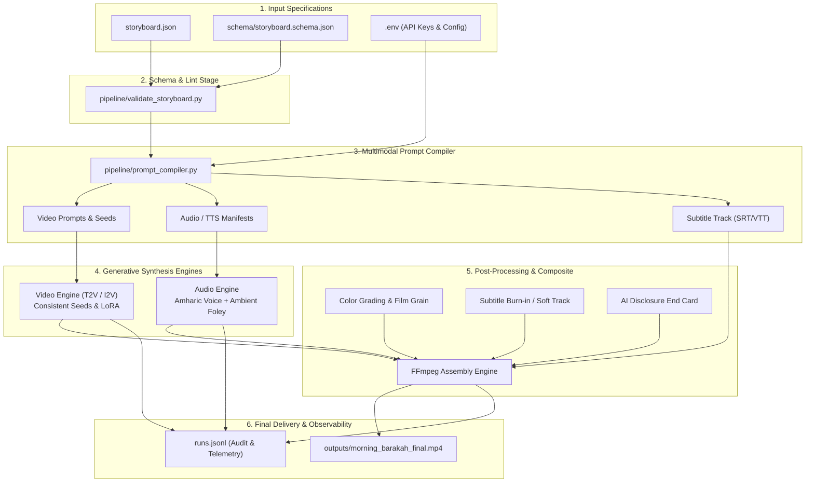

# Pipeline Architecture: "Morning Barakah & The Proverb"

## 1. System Overview

The production pipeline is a decoupled, schema-driven multimodal generative media pipeline. It orchestrates text-to-video, Amharic voice synthesis, Foley assembly, subtitle synchronization, and final composite encoding with automated quality checks.

---

## 2. Component Breakdown

### 2.1 Schema & Validation Layer (`schema/`)
- **File**: `schema/storyboard.schema.json`
- **Purpose**: Enforces strict JSON Schema (Draft-07 / 2020-12) validation across all shot parameters:
  - Total timing invariants (`shot_id`, `start_time_s`, `duration_s`).
  - Required Amharic script text (`voiceover_amharic`) and corresponding English translation (`voiceover_english`).
  - Character consistency locks (clothing seed, lighting tags, camera lens tags).
  - Disclosure and end-card compliance flags.

### 2.2 Prompt Compiler (`pipeline/prompt_compiler.py`)
- Ingests `storyboard.json` and injects global visual stylization tokens:
  - *Positive global anchors*: `cinematic 35mm, warm natural morning light, Ethiopian highland courtyard, photorealistic, Kodak Portra 400 palette`.
  - *Negative universal anchors*: `morphing fingers, duplicate vessels, western modern apparel, oversaturated digital glow, distorted Amharic script`.
- Prepares TTS payloads formatted with SSML pauses matching Amharic prosody.

### 2.3 Visual Generation (T2V / I2V)
- Generates 8 sequential video clips matching target durations.
- Utilizes reference image anchors to maintain consistent facial features and attire for Hajja Mariam across shots 2, 4, and 7.
- Enforces strict frame-rate standards: 24 fps output, 1080p minimum resolution (1920x1080, 16:9).

### 2.4 Audio & Subtitle Generation
- **Voiceover**: Amharic text-to-speech with natural breathing intervals.
- **Foley & Ambience**: Synthesized or sampled stems (charcoal crackle, coffee pouring, morning songbirds).
- **Subtitles**: Automated generation of `subtitles.srt` aligned to word-level audio timestamps.

### 2.5 FFmpeg Post-Processing & End Card Assembly
- Concatenates video segments with smooth 0.3s crossfades or hard cuts as prescribed in the storyboard.
- Mixes audio channels: Dialogue (-14 LUFS integrated), SFX (-18 LUFS), Music bed (-22 LUFS).
- Generates and appends the 8-second AI disclosure end card (Shot 8) before writing the final master: `outputs/morning_barakah_final.mp4`.

### 2.6 Telemetry & Run Logging (`runs.jsonl`)
- Every execution appends a JSON line detailing:
  - `run_id`, `timestamp`, `commit_hash`
  - `model_versions` for video, audio, and synthesis
  - `generation_latency_seconds` per shot
  - `estimated_cost_usd`
  - `quality_gate_passed` (boolean status and human verification notes).
