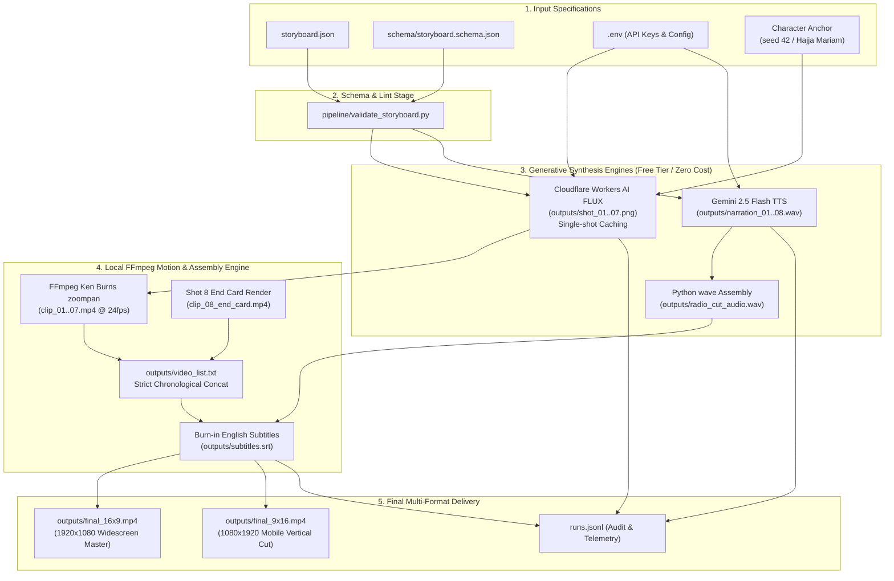

# Pipeline Architecture: "Morning Barakah & The Proverb"

## 1. System Overview

The production pipeline is a decoupled, schema-driven multimodal generative media pipeline. It orchestrates text-to-video, Amharic voice synthesis, Foley assembly, subtitle synchronization, and final composite encoding with automated quality checks.

---

## 2. Component Breakdown

### 2.1 Schema & Validation Layer (`schema/`)
- **File**: `schema/storyboard.schema.json`
- **Purpose**: Enforces strict JSON Schema (Draft-07 / 2020-12) validation across all shot parameters:
  - Total timing invariants (`shot_id`, `start_time_s`, `duration_s`).
  - Required Amharic script text (`voiceover_amharic`) and corresponding English translation (`voiceover_english`).
  - Character consistency locks (fictional persona, clothing seed 42, camera lens tags).
  - Disclosure and end-card compliance flags.

### 2.2 Prompt Compiler (`pipeline/prompt_compiler.py`)
- Ingests `storyboard.json` and outputs structured prompt manifests and subtitle timing maps in `outputs/prompts.json` and `outputs/subtitles.srt`.
- Embeds positive cultural anchors (`authentic Ethiopian highland courtyard, clay jebena, photorealistic 35mm, warm morning light`) and negative universal anchors (`extra fingers, western modern apparel, distorted script, watermarks`).

### 2.3 Visual Still Generation & Single-Shot Caching Workflow
- **Script**: `pipeline/generate_shot_stills.py`
- **Engine**: Cloudflare Workers AI (`@cf/black-forest-labs/flux-1-schnell`).
- **Character Consistency**: Anchored to fictional 68-year-old Hajja Mariam via `outputs/character_sheet.png` and `outputs/hajja_mariam_portrait.jpg`, locked with fixed seed `42`.
- **Smart Caching & Single-Shot Reruns**:
  - The generator inspects `outputs/` before calling the API.
  - Existing shot stills (`shot_01.png` - `shot_07.png`) are preserved (`status: cached`).
  - Only missing or explicitly flagged shots (`--force`) are generated, enabling instantaneous reruns without redundant network overhead or quota consumption.

### 2.4 Amharic Voiceover & Master Radio Cut Assembly
- **Script**: `pipeline/generate_narration.py`
- **Engine**: Google Gemini API (`gemini-2.5-flash-preview-tts`), voice `"Kore"` (warm, serene matriarch tone).
- **Audio Output**: Synthesizes 24kHz 16-bit Linear PCM audio for Shots 1 through 8 into `outputs/narration_01.wav` through `outputs/narration_08.wav`.
- **Timeline Alignment (Master Radio Cut)**:
  - Python's built-in `wave` module stitches each narration clip.
  - Automatically calculates actual speech duration versus storyboard duration and pads gentle silence between shots so dialogue aligns with the 72-second video timeline.
  - Outputs `outputs/radio_cut_audio.wav` (~74.27s total).

### 2.5 Local FFmpeg Motion, Zoompan & Subtitle Burn-in Assembly
To avoid cloud GPU queue contention and cloud video API fees ($0.00 spend):
- **Motion Synthesis (Ken Burns Pan/Zoom)**: Still images are animated into 24 fps 1080p clips (`clip_01.mp4` to `clip_07.mp4`) using FFmpeg's `zoompan` filter with subtle cinematic pushes and drifts matched to each shot's storyboard duration (9s, 10s).
- **Programmatic AI Disclosure End Card**: Shot 8 (`clip_08_end_card.mp4`, 8.0s) is rendered with clean typography via FFmpeg's `drawtext` filter reading from `outputs/end_card_text.txt`.
- **Chronological Concatenation**: Video clips are stitched via `outputs/video_list.txt` using FFmpeg concat demuxer (`-f concat -safe 0`).
- **Audio & Subtitle Multiplexing**: Merges `outputs/radio_cut_audio.wav` and burns high-contrast English subtitles from `outputs/subtitles.srt`.
- **Dual Aspect Ratio Delivery**:
  - **16:9 Widescreen Master**: `outputs/final_16x9.mp4` (1920x1080) for desktop/cinema displays.
  - **9:16 Vertical Cut**: `outputs/final_9x16.mp4` (1080x1920) formatted for mobile platforms and social stories via smart scaling and padding.

### 2.6 Telemetry & Run Logging (`runs.jsonl`)
- Every execution appends an immutable JSON line detailing:
  - `run_id`, `timestamp`, `step`, and `status`.
  - Exact model versions, latencies, and file paths.
  - Ethical compliance declarations (`fictional_character: true`, `non_impersonation: true`).
  - Verified $0.00 spend audit.
